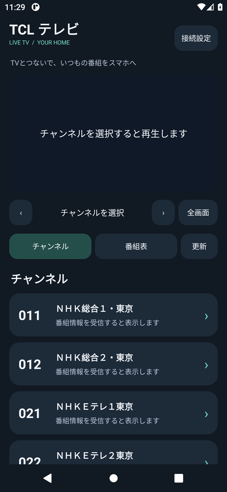

# TCL テレビ Android ビューアー 0.2.0（開発版）

TCL TVのTSをスマートフォンで再生する独立アプリです。番組表・番組詳細・選局に対応します。Android 8以降、ARM64向け。スマートフォン側のrootは不要です。

[APKとZIP](https://github.com/Long0823-1/TCLTV-Android-Viewer/releases) · [画像付きセットアップ](docs/SETUP.md) · [検証結果](docs/validation-v0.2.0.md)



## 0.2.0の変更

- 初回からTVのIPを入力・保存できます。
- TVの確認コードで接続キーとスキャン済み局一覧を取得できます。PCのINIコピーは必須ではなくなりました。
- 接続受付中のTVをLAN内で検索してIPを自動入力します。見つからない場合は手動入力できます。
- カード型のチャンネル一覧と番組表、スクロールできる接続設定画面。
- Android内蔵MediaCodecを優先。未対応時はVLCソフトウェア復号へフォールバックします。
- TextureViewとOpenGLによる映像表示、直接出力の互換モード、診断情報の保存。

Xiaomi 12T Proでの黒画面報告に対応した変更を含みますが、Xiaomi実機で解消したことはまだ確認できていません。Androidエミュレーターで実TSの映像描画・音声デコードを確認しました。このイメージにはMPEG-2用MediaCodecがないため、フォールバック経路の試験です。

## 使い始める

TV側の[TCLTV-Bondriver](https://github.com/Long0823-1/TCLTV-Bondriver)をセットアップ済みの場合は、TVセットアップAPKだけ0.4.2へ更新して「スマートフォンを接続」を開きます。既存の配信設定を再インストールする必要はありません。

スマホをTVと通信できるWi-Fiに接続し、アプリの「接続設定」からTV検索またはIP入力を行い、TVの6桁の確認コードを入力して取得します。TV側は有線LAN・Wi-Fiのどちらでも構いません。初回設定後の視聴にPC・USB・ADBは不要です。

## 制限

家庭内LAN用です。外出先接続、画質変換、録画、字幕・データ放送表示は未実装です。番組表はTSのEITを受信して表示し、最大48時間分を保存します。一部の外字・DRCSは□になります。番組表更新中は選択したチューナーでの視聴が一時停止します。PCとの同時視聴は別のチューナーを選んでください。

## ビルド

Windows PowerShell、JDK、Android SDK Platform 35 / Build-Tools 36.0.0を使用します。

```powershell
.\mobile\build.ps1 -Abi arm64-v8a -SdkRoot C:\path\to\Android\Sdk -JdkRoot C:\path\to\jdk
```

署名鍵は `.local/signing.jks`、パスワードは `.local/signing.pass`、別名は `tclbondriver` です。独自の鍵を用意してください。`-SigningDirectory` で別の保存先も指定できます。依存物は `mobile/dependencies.json` のSHA256で検証します。再生ライブラリを変更する場合は、対応するハッシュも更新して再ビルドできます。

## ライセンスとソース

アプリはMIT、LibVLC 3.7.7はLGPL 2.1です。詳細は `mobile/assets/THIRD_PARTY_NOTICES.txt` とライセンス文書を参照してください。上流ソースアーカイブとJava sources.jarは0.1.0のReleasesにあるsource-bundle ZIPで提供しています。LibVLC依存物は0.2.0でも同じです。TV側の取得機能のソースはTCLTV-Bondriverの `android/src/io/github/long0823/tclbondriver/PhonePairing.java` にあります。