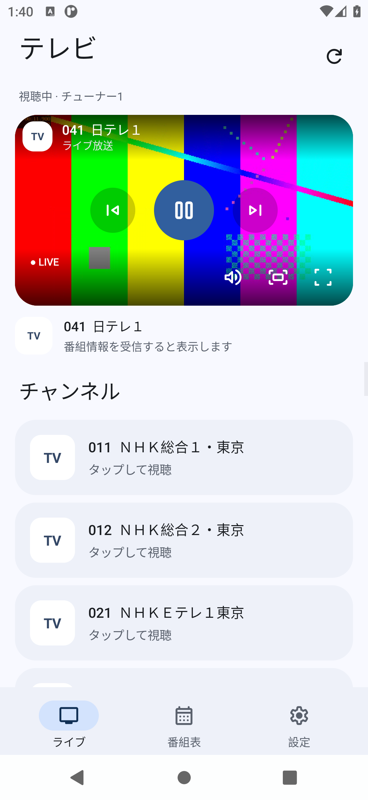
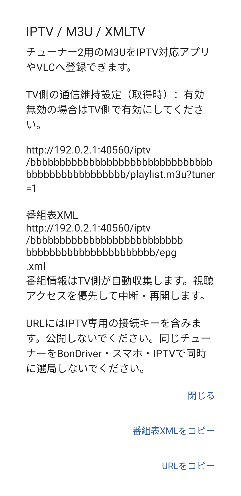
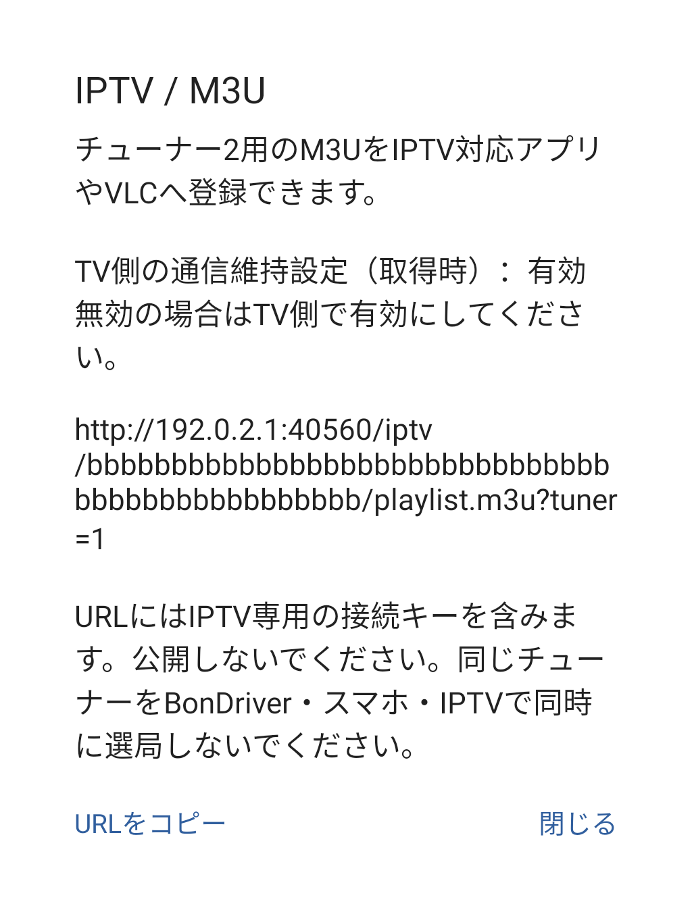
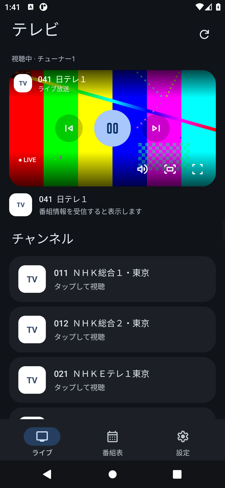

# TCL テレビ Android ビューアー 0.4.1（開発版）

## Magisk適用済みbootイメージの公開（2026-10-27）

TCL 32S5400（G06 / MT5867）向けの **Magisk 25.2（25200）適用済みboot.img** を、別リポジトリで公開しました。ユーザーによる実機起動試験で正常動作を確認しています。

[対応条件・導入説明](https://github.com/Long0823-1/TCL-G06-Magisk-Boot) · [bootイメージとSHA-256をダウンロード](https://github.com/Long0823-1/TCL-G06-Magisk-Boot/releases/tag/magisk-25.2-20261027)

**改変bootを書き込む前に、必ずvbmetaのAVB検証を無効化してください。** ブートローダーのアンロックとは別の操作です。対象TVと同じファームウェアのvbmetaを使用し、元のboot・vbmeta等のバックアップと復旧手段を確保してください。手順は[導入・復旧の説明](https://github.com/Long0823-1/twrp-tcl-g06-mt5867#導入と復旧)を参照してください。機種名が同じでも別基板・別ファームウェア・他個体は未検証です。スマホ視聴アプリを使うスマートフォン自身のroot化は不要です。


TCL TVのTSをスマートフォンで再生する独立アプリです。番組表・番組詳細・選局に対応します。Android 8以降、ARM64向け。スマートフォン側のrootは不要です。

[APKとZIP](https://github.com/Long0823-1/TCLTV-Android-Viewer/releases) · [画像付きセットアップ](docs/SETUP.md) · [検証結果](docs/validation-v0.4.1.md)



画像は自作テスト映像を再生したエミュレーター画面です。公開画像の局ロゴは汎用表示に置き換えています。

## 0.4.1の変更

TV側0.6.0のXMLTV番組表に対応し、「IPTVのM3U接続先」から番組表XML URLをコピーできます。TV更新後、確認コードで接続情報を再取得してください。番組情報の収集はTV側で実行します。

[XMLTVの使い方](docs/IPTV.md) · [TV側の収集手順](https://github.com/Long0823-1/TCLTV-Bondriver/blob/main/docs/XMLTV.md)



画像のIPとキーはテスト用です。

## 0.4.0の変更

TV側0.5.0の消灯時通信維持・IPTVに合わせた更新です。

- TVの確認コードでIPTV専用の接続情報も取得します。
- 「設定」→「IPTVのM3U接続先」でURLを表示・コピーできます。従来のBonDriver認証キーはM3U URLに含めません。
- TV側の通信維持設定を、取得時の状態として表示します。
- 第1チューナーが消灯後に再捕捉する間も待てるよう、短い切断時の再接続と内部中継の接続維持を追加しました。負荷時はTSパケット境界を保って古いデータを捨て、ライブ視聴を優先します。
- 旧INI・旧TV連携との互換性、MediaCodec優先、番組表、全画面・Pixel風UIを維持しています。



画像のIPと接続キーはテスト用です。実際の接続先はTVから取得してください。

[TV側の更新手順](https://github.com/Long0823-1/TCLTV-Bondriver/blob/main/docs/SLEEP_IPTV.md) · [M3Uの使い方](docs/IPTV.md)

## 0.3.0の変更

- Pixelの操作感を参考にした画面構成。下部ナビゲーションでライブ・番組表・設定を切り替えます。
- ライト／ダークに対応。Android 12以降では端末のシステムアクセント色を使います。
- 全画面では横向きになり、ステータスバー・ナビゲーションバーと通常の画面部品を非表示にします。操作パネルは再生中3秒後に消え、タップで戻せます。
- 前後の局、再生／停止、消音を映像上から操作できます。比率維持と画面を埋める拡大を切り替えられます。拡大時は映像の上下または左右が切れます。
- 対応局は実際の放送局ロゴで表示。NHK総合とEテレを区別し、一覧・番組表・再生パネルに表示します。ロゴ画像は同梱せず、外部取得・端末キャッシュ方式です。
- Android内蔵MediaCodec優先、TVからの接続情報取得、TV検索、IP手入力、INI読み込みは引き続き利用できます。

0.2.0でXiaomi 12T Proの映像表示が改善したことを利用者が確認しています。0.3.0の新UIはAndroid 11エミュレーターで検証しました。確認範囲は[検証結果](docs/validation-v0.4.1.md)を参照してください。



## 使い始める

TV側の[TCLTV-Bondriver](https://github.com/Long0823-1/TCLTV-Bondriver)をセットアップ済みの場合は、TV側を0.5.0へ更新・セットアップ・再起動し、通信維持を有効にして「スマートフォンを接続」を開きます。0.5.0はネイティブ配信の更新も含みます。

スマホをTVと通信できるWi-Fiに接続し、アプリの下部の「設定」からTV検索またはIP入力を行い、TVの6桁の確認コードを入力して取得します。TV側は有線LAN・Wi-Fiのどちらでも構いません。初回設定後の視聴にPC・USB・ADBは不要です。

## 制限

家庭内LAN用です。外出先接続、画質変換、録画、字幕・データ放送表示は未実装です。番組表はTSのEITを受信して表示し、最大48時間分を保存します。一部の外字・DRCSは□になります。番組表更新中は選択したチューナーでの視聴が一時停止します。PCとの同時視聴は別のチューナーを選んでください。

## ビルド

Windows PowerShell、JDK、Android SDK Platform 35 / Build-Tools 36.0.0を使用します。

```powershell
.\mobile\build.ps1 -Abi arm64-v8a -SdkRoot C:\path\to\Android\Sdk -JdkRoot C:\path\to\jdk
```

署名鍵は `.local/signing.jks`、パスワードは `.local/signing.pass`、別名は `tclbondriver` です。独自の鍵を用意してください。`-SigningDirectory` で別の保存先も指定できます。依存物は `mobile/dependencies.json` のSHA256で検証します。再生ライブラリを変更する場合は、対応するハッシュも更新して再ビルドできます。

## ライセンスとソース

アプリはMIT、LibVLC 3.7.7はLGPL 2.1です。詳細は `mobile/assets/THIRD_PARTY_NOTICES.txt` とライセンス文書を参照してください。上流ソースアーカイブとJava sources.jarは0.1.0のReleasesにあるsource-bundle ZIPで提供しています。LibVLC依存物は0.4.0でも同じです。AndroidSVGとMaterial Symbolsの表記、および局ロゴの出典は[局ロゴについて](docs/STATION_LOGOS.md)と同梱の第三者ライセンスを参照してください。TV側の取得機能のソースはTCLTV-Bondriverの `android/src/io/github/long0823/tclbondriver/PhonePairing.java` にあります。