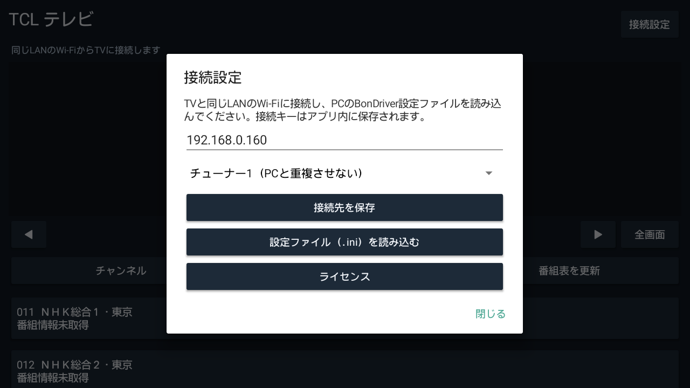

# スマートフォンのセットアップ

このAPKは家庭内LAN用の初期開発版です。TV側は[TCLTV-Bondriver v0.4.1](https://github.com/Long0823-1/TCLTV-Bondriver/releases/tag/v0.4.1)をセットアップし、チャンネルスキャンを完了してください。

1. [Releases](https://github.com/Long0823-1/TCLTV-Android-Viewer/releases)から `TCL-Viewer-0.1.0-arm64-v8a.apk` をスマートフォンへダウンロードしてインストールします。Xiaomi 12T Pro向けはARM64版です。
2. スマートフォンをTVと通信できるWi-Fiにつなぎます。TV側は有線LAN・Wi-Fiのどちらでも構いません。ゲストWi-Fiの端末間通信制限があると接続できません。
3. PCで生成された自分の `BonDriver_TCLG06.ini` または `BonDriver_TCLG06_1.ini` をスマートフォンへコピーします。
4. アプリ右上の「接続設定」→「設定ファイル（.ini）を読み込む」を押し、コピーしたファイルを選びます。
5. TVのIPアドレスとチューナーを確認します。PCと同時視聴するときは、PCとは別のチューナーを選んでください。
6. 設定を閉じて局を選ぶと、アプリ内で再生します。
7. 「番組表を更新」を押し、確認ダイアログで開始すると、各放送波を受信して番組情報を集めます。取得中はそのチューナーでの視聴が一時停止します。「取得を中止」で止められます。
8. 「番組表」で番組をタップすると詳細が開き、その局を視聴できます。

画像はAndroid TV環境での動作試験時の画面です。Xiaomiで撮影した画像ではありません。画面サイズによって配置が変わります。

設定ファイルの接続キーはアプリ内に保存されます。INIをGitHub・SNSなどへ公開しないでください。視聴を終えてアプリがバックグラウンドになると受信を止めます。アプリ内で録画は行いません。

## 見られないとき

- TVの電源、TV配信の起動状態、同じLANへの接続、IPアドレスを確認します。
- 同じチューナーを別の視聴ソフトが使っている場合は、別のチューナーを指定します。
- 放送されていない枝番号サービスは再生できません。読み込む局一覧はPC側で再スキャンして更新します。
- 初回は番組情報が空欄です。受信や番組表更新で埋まります。一部の外字は□表示です。
- 外出先からの視聴機能はまだありません。

検証済み範囲と未確認事項は[検証結果](validation-v0.1.0.md)を参照してください。