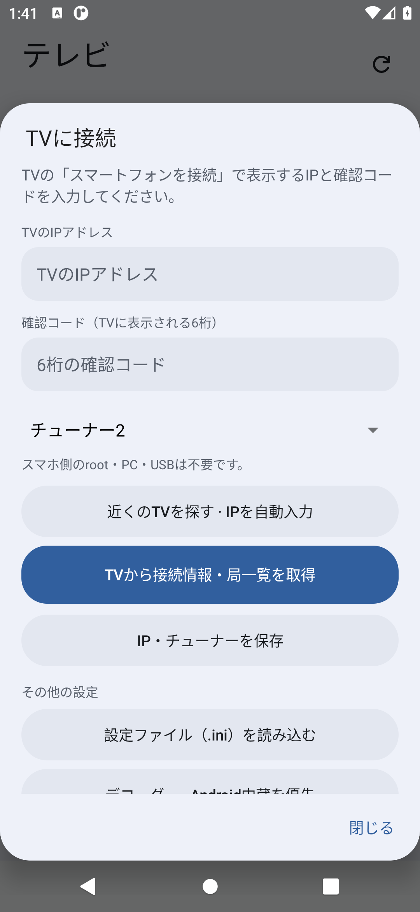
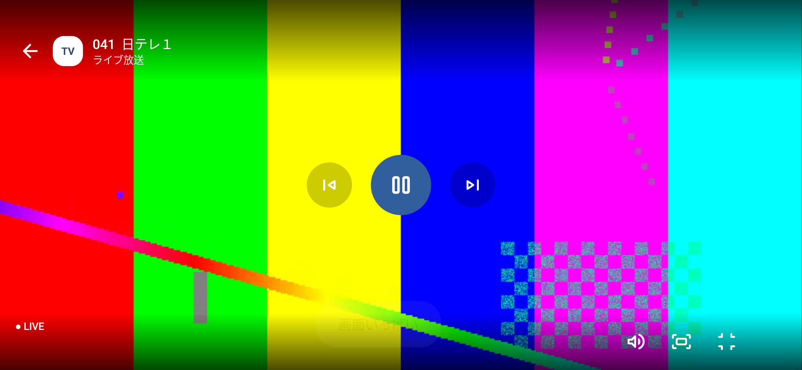

# スマートフォンのセットアップ（0.4.0）

## TV側の準備

TV側を0.5.0へ更新し、TVで「セットアップ」と再起動を実行します。ネイティブ配信も更新するため、APKの上書きだけでは完了しません。通信維持が有効になったことを確認してから、「スマートフォンを接続（確認コードを表示）」を選んでください。

TV画面に6桁の確認コードと受付の案内が表示されます。コードは2分間・1回限り有効です。TVで他のアプリを開くか、受付を終了すると無効になります。取得を終えてからYouTubeやTVerへ戻せます。

初めてTVの配信を導入する場合は、先に[TCLTV-Bondriverの手順](https://github.com/Long0823-1/TCLTV-Bondriver)でセットアップとチャンネルスキャンを完了してください。

## スマホ側の操作

1. [Releases](https://github.com/Long0823-1/TCLTV-Android-Viewer/releases)の `TCL-Viewer-0.4.0-arm64-v8a.apk` をインストールします。旧版がある場合は上書きできます。
2. TVと通信できるWi-Fiにつなぎ、下部の「設定」を開きます。TVは有線LANでもWi-Fiでも構いません。
3. 「近くのTVを探す」でIPを自動入力します。見つからない場合は、TV画面のIPを手動入力できます。
4. TVの6桁を入力し、PCと重複しないチューナーを選び、「TVから接続情報・局一覧を取得」を押します。
5. 局を選ぶとアプリ内で再生します。上部の更新アイコンは各放送波を順番に受信して番組表を集めます。取得中はそのチューナーでの視聴が一時停止します。
6. 番組表の番組をタップすると詳細を開き、その局を視聴できます。

画像はAndroid 11エミュレーターでの実行画面です。公開画像の局ロゴは汎用表示に置き換えています。Xiaomi実機で撮影した画像ではありません。設定画面は上下にスクロールできます。

PCで生成したINIの読み込みも引き続き使えます。接続キーを含むためINIを公開しないでください。IPを先に保存してからINIを読み込んだ場合は、保存したIPとチューナーが反映されます。

## 音声だけ出て映像が黒いとき

0.3.0はAndroid内蔵MediaCodecを優先します。未対応の場合はVLCへ戻します。「接続設定」内で次を試せます。

- 「デコーダー」からAndroid内蔵とVLCソフトウェアを切り替える。
- 「映像が黒いとき」からOpenGLと互換モードを切り替える。変更後は局を選び直します。
- 「再生の診断情報」で対応MPEG-2デコーダー、映像デコード数、描画数、受信量を確認・保存する。接続キーは診断に含みません。

0.2.0でXiaomi 12T Proの映像表示が改善したことを利用者が確認しています。[検証結果](validation-v0.3.0.md)に実際に確認した範囲を記載しています。

## 検索・取得できないとき

TV側で0.5.0の受付を開いているか、有効なコードか、同じLANで端末同士が通信できるかを確認します。ゲストWi-Fiやマルチキャスト制限のあるLANでは検索できない場合があります。その場合はIPを手入力してください。エミュレーターのNAT経由ではTV検索を確認できていません。インターネット越しの接続機能は未実装です。
## 視聴の操作

- 映像をタップすると再生パネルを表示します。再生中は3秒後に自動で消えます。
- 右下の全画面アイコンで横向きの全画面にします。戻る矢印かAndroidの戻る操作で通常画面へ戻ります。
- 拡大アイコン、またはピンチ操作で比率維持／画面いっぱいに拡大を切り替えます。比率維持では画面の縦横比に応じて黒帯が出ます。拡大時は映像の一部が切れます。
- 前後の局、再生／停止、消音も再生パネルから操作できます。停止後の再生は現在の放送へ接続し直します。
- 局一覧・番組表には対応局の実際のロゴを表示します。未登録局や取得失敗時は局名の短縮表示になります。設定からロゴを再読み込みできます。

全画面画像はエミュレーター上で自作テスト映像を再生したものです。実際の放送映像ではありません。
## M3U / IPTVへ登録する

TVから接続情報を取り直した後、下部の「設定」→「IPTVのM3U接続先」→「URLをコピー」でIPTV対応アプリへ貼り付けられます。[詳しい使い方](IPTV.md)を参照してください。

画面消灯時の通信維持はTV側で設定します。第1チューナーの再捕捉中は短く映像・音声が止まる場合があります。TVの通常の省電力待機より消費電力が増えます。