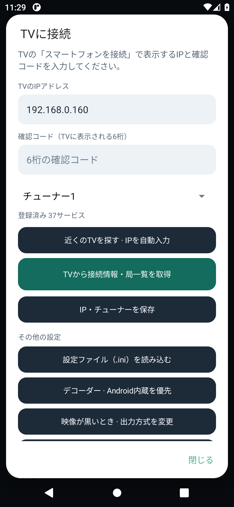

# スマートフォンのセットアップ（0.2.0）

## TV側の準備

TCLTV-Bondriverが動作中の場合は、TVセットアップAPKを0.4.2へ更新します。既存ユーザーは「セットアップ」や「テレビを再起動」を再実行する必要はありません。「スマートフォンを接続（確認コードを表示）」を選んでください。

TV画面に6桁の確認コードと受付の案内が表示されます。コードは2分間・1回限り有効です。TVで他のアプリを開くか、受付を終了すると無効になります。取得を終えてからYouTubeやTVerへ戻せます。

初めてTVの配信を導入する場合は、先に[TCLTV-Bondriverの手順](https://github.com/Long0823-1/TCLTV-Bondriver)でセットアップとチャンネルスキャンを完了してください。

## スマホ側の操作

1. [Releases](https://github.com/Long0823-1/TCLTV-Android-Viewer/releases)の `TCL-Viewer-0.2.0-arm64-v8a.apk` をインストールします。旧版がある場合は上書きできます。
2. TVと通信できるWi-Fiにつなぎ、「接続設定」を開きます。TVは有線LANでもWi-Fiでも構いません。
3. 「近くのTVを探す」でIPを自動入力します。見つからない場合は、TV画面のIPを手動入力できます。
4. TVの6桁を入力し、PCと重複しないチューナーを選び、「TVから接続情報・局一覧を取得」を押します。
5. 局を選ぶとアプリ内で再生します。「更新」は各放送波を順番に受信して番組表を集めます。取得中はそのチューナーでの視聴が一時停止します。
6. 番組表の番組をタップすると詳細を開き、その局を視聴できます。

画像はAndroid 11エミュレーターでの実行画面です。Xiaomi実機で撮影した画像ではありません。設定画面は上下にスクロールできます。

PCで生成したINIの読み込みも引き続き使えます。接続キーを含むためINIを公開しないでください。IPを先に保存してからINIを読み込んだ場合は、保存したIPとチューナーが反映されます。

## 音声だけ出て映像が黒いとき

0.2.0はAndroid内蔵MediaCodecを優先します。未対応の場合はVLCへ戻します。「接続設定」内で次を試せます。

- 「デコーダー」からAndroid内蔵とVLCソフトウェアを切り替える。
- 「映像が黒いとき」からOpenGLと互換モードを切り替える。変更後は局を選び直します。
- 「再生の診断情報」で対応MPEG-2デコーダー、映像デコード数、描画数、受信量を確認・保存する。接続キーは診断に含みません。

Xiaomi 12T Proでの解消確認は未完了です。[検証結果](validation-v0.2.0.md)に実際に確認した範囲を記載しています。

## 検索・取得できないとき

TV側で0.4.2の受付を開いているか、有効なコードか、同じLANで端末同士が通信できるかを確認します。ゲストWi-Fiやマルチキャスト制限のあるLANでは検索できない場合があります。その場合はIPを手入力してください。エミュレーターのNAT経由ではTV検索を確認できていません。インターネット越しの接続機能は未実装です。